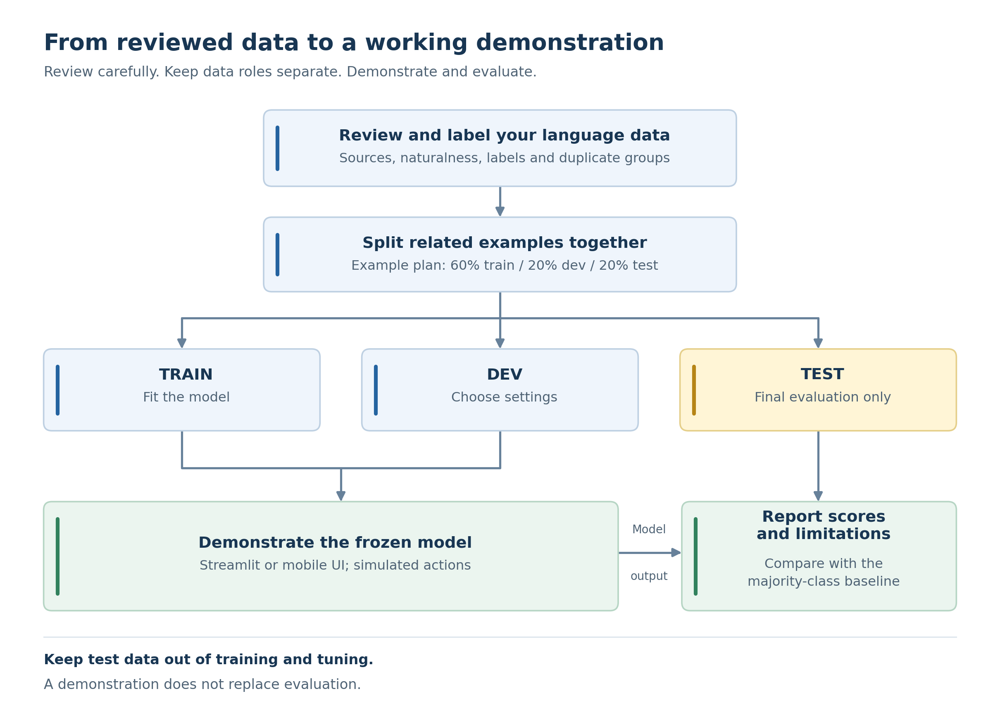

# Strathmore NLP Hub Datathon starter kit v2.0
Choose one supported track: intent, sentiment, or limited semantic parsing. See TRACKS.md, NEXT_STEPS.md, NATURAL_DATA.md and examples/. Python 3.10 or later is recommended.

## Install (from this folder)
python -m venv .venv
# macOS/Linux:
source .venv/bin/activate
# Windows PowerShell instead:
.venv\Scripts\Activate.ps1
python -m pip install -r requirements.txt

Use only the activation command for your OS.
## Practice first
python validate.py --track intent --data data/practice_intent.csv --practice
python train.py --track intent --data data/practice_intent.csv --practice
python evaluate.py --track intent --data data/practice_intent.csv --practice
python -m streamlit run app.py

For sentiment, substitute --track sentiment and data/practice_sentiment.csv; for semantic parsing use --track semantic and data/practice_semantic.csv. Train each desired track before selecting it in the app. Artifacts live in artifacts/<track>/ so tasks do not overwrite each other.

## Your contribution
Copy data/template.csv (or semantic_template.csv) to data/contribution.csv. Use label for the class; legacy intent headers are accepted for backwards compatibility. Follow track-specific minimums. Run the same commands with --data data/contribution.csv and WITHOUT --practice. Do not count teaching fixtures as contributions.
Each training run stores a dataset fingerprint. Evaluation rejects changed data or a mismatched track/mode; regenerate the model deliberately if you correct your dataset before freezing.
Choose settings with development data. Freeze then evaluate test once. Accuracy and macro-F1 are printed with per-label F1 bars and saved as JSON/CSV. Semantic adds slot F1 and full-frame exact match.
No minimum F1 is guaranteed. Practice examples are constructed, small and easier than realistic data; their scores are teaching results, not a production benchmark.

## Workflow

## Files
taxonomy.csv: 10 action labels, English boundaries and Kiswahili illustrations (local fluent review still needed).
sentiment_guidelines.md: opinion labels and exclusions.
data/: empty templates and English practice sets (100 intent,100 semantic,120 sentiment).
validate.py: basic structural, review, source-method, duplicate and split-group checks; also checks semantic spans.
train.py: CPU character-TF-IDF/logistic-regression baseline and majority comparator. Semantic adds a training-only surface-slot dictionary.
evaluate.py: console scores, per_label_report.csv, test_predictions.csv and test_metrics.json. No audio or network dataset download.
app.py: Streamlit labels, uncalibrated model probability, semantic JSON when applicable. Mobile app is an equivalent optional interface.
templates/: blank planning, annotation, data-card, quality and contribution outlines.
examples/: completed fictional teaching documents. Never copy their permission/evaluation claims into a real submission.

## Scope and disclosure
Intent describes requested action; sentiment describes opinion; limited semantic parsing adds slots. Sentiment is not emotion detection; semantic baseline is not a general text-to-SQL system. The slot baseline cannot extract unknown surface values reliably. Report failures on an explicit unseen-value test subset.
Reuse and credit this starter code. Document other datasets, models, AI tools and changes. Keep private data/permission evidence out of public GitHub. Do not open untrusted joblib files.
Use your own GitHub repo now. A final NLP Hub repository and submission process will be announced. Deadline:11 November 2026,11:59 p.m. EAT. Do not guess a submission URL.

